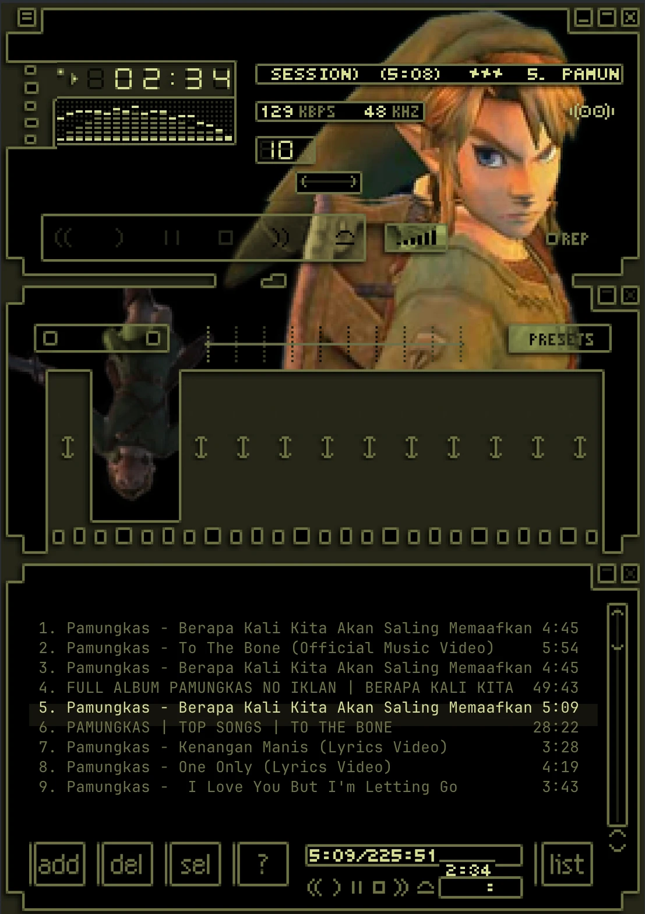
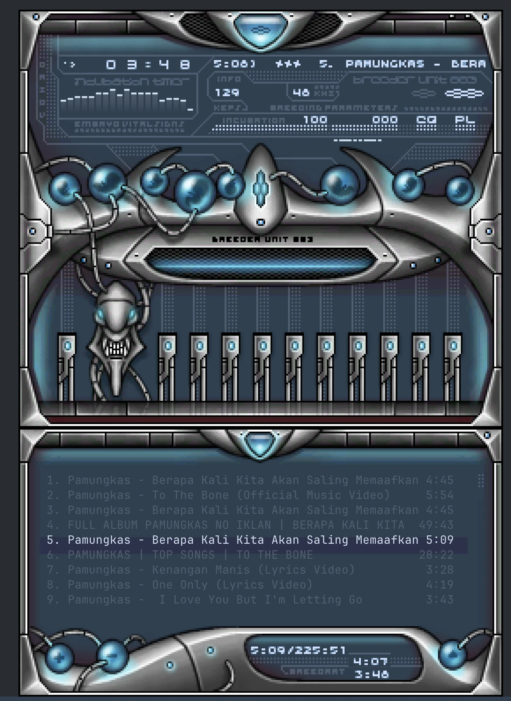

# rustune

A lightweight terminal music player: a single small binary with no mpv or other runtime dependencies. Native Rust audio engine, visualizer, synced lyrics, Internet radio, podcasts, self-hosted servers and pixel-accurate Winamp skins, all in your terminal.

**[Website](https://rustune.dzulfikar.com)** | **[Releases](https://github.com/dzulfikar08/rustune/releases)** | **[Contributing](CONTRIBUTING.md)**

> rustune is not affiliated with any content platform. Online audio search requires a third-party extractor (yt-dlp). Users are responsible for complying with the terms of service of any content they access.

## Features

- **Native audio engine** (cpal + symphonia): gapless playback, 10-band EQ with Winamp presets and preamp, ReplayGain (track/album), balance, volume
- **Streams**: HTTP streams with ICY (now-playing) titles, radio playlists (`.pls` / `.m3u`); optional ffmpeg for exotic formats and HLS
- **Visualizer**: `bars`, `braille`, `led`, `mirror`, `scope`, `spectrogram`, `fire`, or `none`
- **Lyrics**: fetched from [LRCLIB](https://lrclib.net), synced line-by-line when available
- **Sources**
  - Local library (MP3, FLAC, OGG, WAV, M4A, AAC, OPUS, WMA)
  - Online search and download via yt-dlp (optional)
  - Internet radio ([Radio Browser](https://www.radio-browser.info))
  - Podcasts (iTunes charts and search, subscriptions)
  - Subsonic / Navidrome and Jellyfin / Emby, when configured
- **Winamp 2.x skins** (`.wsz`): pixel-accurate rendering with kitty, iTerm2 or sixel graphics, or a half-block fallback; a built-in browser for the whole [Winamp Skin Museum](https://skins.webamp.org/) (100,000+ skins) with a live preview of each skin
- **Playlists**: load and save `.m3u` / `.pls`
- **Session restore**: volume, balance, EQ, shuffle/repeat, visualizer, queue and resume position
- **Themes**: Dark, Light and Winamp (`t` cycles, `:theme light` picks); full mouse support
- **Command palette**: `?` / `Ctrl+K` lists every action for the current view with its key and current value, fuzzy-filtered as you type
- **Remote control**: everything from the command line over a local socket: playback, queue editing (`list`, `jump`, `move`, `remove`), searching every source (`rustune search online lofi --play 1`), themes, skins and visualizers, lyrics, and driving the TUI itself (`rustune key`, `rustune screen`); a headless `--daemon` mode; `rustune FILE` queues into the running player instead of starting a second one
- **Media keys and now-playing widgets**: MPRIS2 on Linux (`playerctl`, GNOME/KDE media controls), Now Playing and the media keys on macOS; in the TUI and in `--daemon` mode

## Screenshots

<table>
  <tr>
    <td></td>
    <td></td>
  </tr>
  <tr>
    <td align="center">Zelda</td>
    <td align="center">Breeder</td>
  </tr>
</table>

Both skins come from the [Winamp Skin Museum](https://skins.webamp.org/) and are drawn from their own bitmaps, right in the terminal.

## Lightweight

rustune is inspired by [cliamp](https://github.com/bjarneo/cliamp), a great Winamp-style terminal player, and aims to do the same job with far fewer resources. Measured on an Apple M1 MacBook Air (8 GB), rustune 0.3.6 vs cliamp 2.3.0, both at their defaults with the visualizer on, playing the same 192 kbps MP3, 30 s windows, whole process tree, repeated runs:

| | rustune | cliamp |
|---|---|---|
| macOS arm64 binary | 5.2 MB | 34.9 MB |
| Linux x86_64 binary | 6.5 MB | 38.0 MB |
| RAM while playing | 29 MB | 63 MB |
| CPU while playing (TUI) | 3.5 % | 15 % |
| CPU while playing (`--daemon`) | 0.9 % | 6.1 % |
| CPU while paused | 0.14 % | 0.58 % |
| Playing a YouTube song | one process, 31 MB | player + yt-dlp (82 MB) + ffmpeg (15 MB) for the whole song |

cliamp supports more streaming services (Spotify, Tidal, Qobuz) and Lua plugins; rustune has full `.wsz` skins and ReplayGain.

### How rustune uses yt-dlp

yt-dlp is great at finding audio, but it is a Python program. rustune only asks it one question: where is the audio file?

- **Spawn, ask, exit.** yt-dlp runs once per song (about 1.7 s) to get the stream link, with a timeout. If you skip or stop before it answers, rustune kills it.
- **Pick a format rustune can play.** rustune asks for AAC (YouTube format 140), which its own decoder handles, so no ffmpeg runs behind the song.
- **Instant seeking.** The audio streams over plain HTTP, so jumping ahead is a range request instead of restarting a pipeline.

Sources that only offer HLS or Opus (some SoundCloud tracks) still go through ffmpeg.

## Installation

| Platform | Channel | Command |
|----------|---------|---------|
| macOS, Linux | install script | `curl -fsSL https://raw.githubusercontent.com/dzulfikar08/rustune/master/install.sh \| sh` |
| macOS, Linux | [Homebrew](https://github.com/dzulfikar08/homebrew-tap) | `brew install dzulfikar08/tap/rustune` |
| Windows | [Scoop](https://github.com/dzulfikar08/scoop-bucket) | `scoop bucket add rustune https://github.com/dzulfikar08/scoop-bucket` then `scoop install rustune` |
| Debian, Ubuntu | `.deb` from [Releases](https://github.com/dzulfikar08/rustune/releases) | `sudo apt install ./rustune_*_amd64.deb` (or `_arm64.deb`) |
| Fedora, RHEL, openSUSE | `.rpm` from [Releases](https://github.com/dzulfikar08/rustune/releases) | `sudo dnf install ./rustune-*.x86_64.rpm` (or `.aarch64.rpm`) |
| NixOS, any Nix | flake | `nix run github:dzulfikar08/rustune` or `nix profile install github:dzulfikar08/rustune` |
| any | [cargo-binstall](https://github.com/cargo-bins/cargo-binstall) | `cargo binstall --git https://github.com/dzulfikar08/rustune rustune` |
| any | from source | `cargo install --git https://github.com/dzulfikar08/rustune` |
| Arch Linux | AUR (coming soon) | `yay -S rustune-bin` or `yay -S rustune` |
| Linux | Snap Store (coming soon) | `sudo snap install rustune` |
| any | crates.io (coming soon) | `cargo install rustune` or `cargo binstall rustune` |
| Windows | winget (coming soon) | `winget install dzulfikar08.rustune` |

The Linux builds need glibc and the ALSA library at runtime (`libasound2`, called `alsa-lib` on Fedora and Arch); the packages pull it in. Online search and streaming need [yt-dlp](https://github.com/yt-dlp/yt-dlp), and [ffmpeg](https://ffmpeg.org/) adds exotic formats and HLS streams: install both with your package manager (`brew install yt-dlp ffmpeg`, `scoop install yt-dlp ffmpeg`, `sudo apt install yt-dlp ffmpeg`). Run `rustune doctor` to check.

### Install script

`install.sh` picks the release binary for your OS and CPU, checks it against the release's SHA256 checksums and installs it to `~/.local/bin`. It honours `RUSTUNE_INSTALL_DIR` (install folder) and `RUSTUNE_VERSION` (a release tag such as `v0.3.7`), and warns when the folder is not on your `PATH`:

```bash
export PATH="$HOME/.local/bin:$PATH"
```

### From Release

Every [release](https://github.com/dzulfikar08/rustune/releases) has:

- bare binaries: `rustune-aarch64-macos`, `rustune-x86_64-macos`, `rustune-x86_64-linux`, `rustune-aarch64-linux`, `rustune-x86_64-windows.exe`
- archives with the binary, README and LICENSE: `rustune-<version>-<target>.tar.gz` (`.zip` for Windows)
- `.deb` and `.rpm` packages for x86_64 and arm64 Linux
- signed and notarized macOS apps: `rustune-aarch64-macos.dmg`, `rustune-x86_64-macos.dmg`
- `SHA256SUMS` for all of the above (`sha256sum -c SHA256SUMS --ignore-missing`)

To install a bare binary by hand:

```bash
mkdir -p ~/.local/bin
cp ~/Downloads/rustune-aarch64-macos ~/.local/bin/rustune
chmod +x ~/.local/bin/rustune
```

### Requirements

- To build: [Rust](https://rustup.rs/) (latest stable). On Linux, the ALSA development headers (`libasound2-dev` on Debian/Ubuntu, `alsa-lib-devel` on Fedora).
- Optional at runtime:
  - [yt-dlp](https://github.com/yt-dlp/yt-dlp): online search and download
  - [ffmpeg](https://ffmpeg.org/): formats symphonia can't decode, and HLS streams

### From Source (cargo)

```bash
cargo install --git https://github.com/dzulfikar08/rustune
```

### From Source (manual)

```bash
git clone https://github.com/dzulfikar08/rustune.git
cd rustune
cargo build --release
cp target/release/rustune /usr/local/bin/
```

## First Run

When you launch rustune for the first time, it will guide you through a short setup:

1. **Music directory**: point rustune to your local music folder
2. **Theme**: choose between Dark, Light, or Winamp style
3. **Ready**: start browsing and playing

To check optional tools and paths, run:

```bash
rustune doctor
```

## Usage

```bash
rustune [FILE|DIR|URL|PLAYLIST]...
```

| Command | Description |
|---------|-------------|
| `rustune` | Launch the TUI (restores the last session) |
| `rustune FILE\|DIR\|URL\|PLAYLIST...` | Replace the queue with the given items and play. Directories are scanned recursively; URLs may be http(s) streams or YouTube, SoundCloud, Bandcamp, Vimeo or Mixcloud pages (via yt-dlp); playlists are `.m3u` / `.m3u8` / `.pls`. If rustune is already running, the items are appended to its queue instead |
| `rustune --daemon [ITEM...]` | Run without a terminal UI (same engine, queue and session state), controlled with the commands below; SIGINT/SIGTERM save the session and exit |
| `rustune doctor` | Check optional tools and paths |
| `rustune --help` | Show help |
| `rustune --version` | Show version |

### Keybindings

Press `?` or `Ctrl+K` anywhere in the player for the **command palette**: every action that works in the current view, with its keys, a description and the current value of toggles (shuffle, repeat, EQ, visualizer, theme, …). Type to fuzzy-filter, `↑`/`↓` to pick, `Enter` to run. The hint bar at the bottom shows the most useful keys for the current view.

The tables below are generated from the key table in `src/keymap.rs` (the same table the key handler and the palette read); `cargo test` fails when they are out of date.

<!-- keymap:start -->
#### Playback

| Key | Action |
|-----|--------|
| `z` | Previous track |
| `x` | Play (restarts a playing track) |
| `Space` / `c` | Pause / resume |
| `v` | Stop |
| `b` | Next track |
| `←` | Seek back 5 s |
| `→` | Seek forward 5 s |
| `Shift+←` | Seek back 30 s |
| `Shift+→` | Seek forward 30 s |
| `Ctrl+J` | Jump to a time (:seek) |
| `+` / `=` | Volume up |
| `-` | Volume down |
| `S` | Toggle shuffle |
| `R` | Cycle repeat (off, all, one) |
| `o` | Turn the EQ on or off |
| `[` | Previous EQ preset |
| `]` | Next EQ preset |
| *palette* | Stop and clear the queue |

#### Panels, themes and general

| Key | Action |
|-----|--------|
| `e` | Toggle the EQ panel |
| `P` | Toggle the playlist window |
| `y` | Toggle the lyrics panel |
| `V` | Cycle the visualizer mode |
| `t` | Cycle the theme (Dark, Light, Winamp) |
| `l` | Open a file, folder, URL or playlist |
| `w` | Save the queue as an .m3u playlist |
| `Tab` | Next source tab |
| `Shift+Tab` | Previous source tab |
| `s` | Settings |
| `:` | Type a : command (e.g. :theme light) |
| `?` / `Ctrl+K` | Command palette: every action, filterable |
| `q` / `Ctrl+C` | Quit |

#### Lists (library, provider tabs, playlist, skin browser)

| Key | Action |
|-----|--------|
| `j` / `↓` | Move down |
| `k` / `↑` | Move up |
| `g` / `Home` | First item |
| `G` / `End` | Last item |
| `PgDn` | Page down |
| `PgUp` | Page up |
| `Enter` | Play the selection (library: the list from there; providers: open folders) |
| `a` | Append the selection to the queue |
| `A` | Play the selection next |

#### Library (Local and Online tabs)

| Key | Action |
|-----|--------|
| `/` | Search (or type a : command) |
| `n` | Next result page (Online) |
| `p` | Previous result page (Online) |
| `d` | Download the selection (Online) |

#### Provider tabs (Radio, Podcasts, Subsonic, Jellyfin)

| Key | Action |
|-----|--------|
| `/` | Search this source |
| `Backspace` / `Esc` | Up a level |
| `r` | Reload the current level |
| `f` | Subscribe to or unsubscribe from the podcast |

#### Playlist (the P window; in Winamp the skin's playlist editor)

| Key | Action |
|-----|--------|
| `J` | Move the track down |
| `K` | Move the track up |
| `D` / `Del` | Remove the track from the queue |
| `B` | Winamp: browse Radio, Podcasts, Subsonic or Jellyfin in the playlist editor |

#### EQ panel (e)

| Key | Action |
|-----|--------|
| `←` / `h` | Previous slider |
| `→` / `l` | Next slider |
| `↑` / `k` | Raise the slider 1 dB |
| `↓` / `j` | Lower the slider 1 dB |
| `K` | Raise the slider 3 dB |
| `J` | Lower the slider 3 dB |
| `0` | Reset the slider to 0 dB |
| `Esc` | Close the EQ panel |

#### Skin browser (Settings → Theme Winamp → i or o)

| Key | Action |
|-----|--------|
| `Enter` | Apply the highlighted skin (Online: install it first) |
| `/` | Search every classic skin in the museum (Online) |
| `f` | Switch between the whole museum and curated skins (Online) |
| `Tab` | Switch between installed and online skins |
| `r` | Reload the list |
| `Esc` / `q` | Clear the search, or go back to Settings |

#### Prompt (search, : commands, save, open)

| Key | Action |
|-----|--------|
| `Enter` | Submit |
| `Esc` | Cancel |
| `↑` | Previous search |
| `↓` | Next search |
| `←` | Cursor left |
| `→` | Cursor right |
| `Home` / `Ctrl+A` | Start of the line |
| `End` / `Ctrl+E` | End of the line |
| `Backspace` | Delete before the cursor |
| `Del` | Delete at the cursor |
| `Ctrl+U` | Clear the input |

#### Command palette (? or Ctrl+K)

| Key | Action |
|-----|--------|
| `↑` / `Ctrl+P` | Previous entry |
| `↓` / `Ctrl+N` | Next entry |
| `Enter` | Run the selected entry |
| `Backspace` | Delete a filter character |
| `Ctrl+U` | Clear the filter |
| `Esc` / `Ctrl+K` | Close the palette |

<!-- keymap:end -->

#### Commands (type after `/` or `:`)

| Command | Action |
|---------|--------|
| `:q` | Quit |
| `:clear` | Clear the queue |
| `:eq <preset>` / `:eq toggle` / `:eq auto` | Load an EQ preset / toggle EQ / auto preset |
| `:vol N` | Set volume |
| `:bal N` | Set balance |
| `:seek 90` / `:seek 1:30` / `:seek +10` / `:seek -10` | Seek absolute or relative |
| `:repeat off\|all\|one` | Set repeat mode |
| `:shuffle` | Toggle shuffle |
| `:play` / `:pause` / `:toggle` / `:stop` | Transport |
| `:next` / `:prev` | Next / previous track |
| `:preamp dB` | Set EQ preamp |
| `:band 1-10 dB` | Set one EQ band |
| `:open` | Open file / URL |
| `:theme` / `:theme dark\|light\|winamp` | Cycle the theme / switch to a theme |

#### Mouse

Click a row to play it, use the wheel to scroll, and click the progress bar to seek. In Winamp mode every skin button and slider works with click and drag.

### Remote control

A running player (TUI or `--daemon`) listens on a local control socket: `$XDG_RUNTIME_DIR/rustune.sock`, falling back to the config directory (mode `0600`), or the named pipe `\\.\pipe\rustune` on Windows. `RUSTUNE_SOCKET` overrides the path, e.g. to run two instances. A socket left behind by a crash is detected and replaced.

Every command talks to the running instance and exits with status 1 and a message when none is running (2 for a malformed command line). Queue and search positions start at 1.

| Command | Action | Example |
|---------|--------|---------|
| `play` / `pause` / `toggle` / `stop` / `next` / `prev` | Transport | `rustune toggle` |
| `status [--json]` | Now playing, time, volume, balance, shuffle, repeat, EQ, queue position, source tab, view, theme, visualizer, yt-dlp lookup in flight, last error | `rustune status --json` |
| `volume 0-100\|+N\|-N` | Set or change the volume (percent) | `rustune volume +5` |
| `seek SECS\|MM:SS\|+N\|-N` | Jump to a position or skip N seconds | `rustune seek 1:30` |
| `shuffle` | Toggle shuffle | `rustune shuffle` |
| `repeat [off\|all\|one]` | Set the repeat mode (cycle without an argument) | `rustune repeat all` |
| `eq PRESET\|on\|off\|toggle` | Apply a preset (turns the EQ on), or switch the EQ | `rustune eq rock` |
| `watch` | Print a JSON status line on every change | `rustune watch` |
| `queue ITEM...` | Append files, directories, playlists or URLs | `rustune queue ~/Music/album https://youtu.be/ID` |
| `list [--json]` | The queue: position, title, duration, source; `>` marks the playing track, `*` the cursor | `rustune list` |
| `jump N` | Play queue entry N | `rustune jump 3` |
| `remove N` | Remove queue entry N | `rustune remove 2` |
| `move FROM TO` | Move queue entry FROM to position TO | `rustune move 5 1` |
| `clear` | Stop and empty the queue | `rustune clear` |
| `search SOURCE QUERY... [--limit N] [--json] [--queue \| --play N]` | Search `local`, `online` (yt-dlp), `radio`, `podcasts`, `subsonic` or `jellyfin` inside the player, the same way its tabs do, and print numbered results. `--queue` appends every playable result; `--play N` replaces the queue with the results and plays result N. Podcast results are shows: `--play N` loads that show's episodes and plays the newest; an album result plays from its first track | `rustune search online lofi beats --play 1` |
| `theme dark\|light\|winamp` | Switch the theme | `rustune theme winamp` |
| `vis MODE\|next\|list` | Visualizer: `bars`, `braille`, `led`, `mirror`, `scope`, `spectrogram`, `fire`, `none` | `rustune vis scope` |
| `skin NAME\|MD5\|FILE.wsz` | Apply a Winamp skin (and the Winamp theme): an installed skin by name, a [Skin Museum](https://skins.webamp.org/) md5 (an installed skin with the same content is used as is, otherwise it is downloaded under its museum file name) or a `.wsz` file (copied into the skins folder) | `rustune skin 5e4f10275dcb1fb211d4a8b4f1bda236` |
| `lyrics [--json]` | Lyrics of the current track, or why there are none | `rustune lyrics` |
| `key KEY... [--text WORDS]` | Press keys in the TUI exactly as if typed (see below) | `rustune key ?` |
| `screen [--ansi] [--json]` | Print the last frame the TUI drew: plain text, with ANSI colours, or as JSON with the prompt's cursor position | `rustune screen` |
| `send 'JSON'` | Send one raw protocol request and print the raw reply | `rustune send '{"get":"queue"}'` |
| `quit` | Stop the running instance | `rustune quit` |

Page URLs on `youtube.com` (also `www.`, `m.`, `music.`), `youtu.be`, `soundcloud.com`, `*.bandcamp.com`, `vimeo.com` and `mixcloud.com` are played through yt-dlp, both as arguments (`rustune https://youtu.be/ID`) and with `rustune queue`; the queue shows the URL until yt-dlp reports the title. Direct media URLs (`https://host/stream.mp3`) stream natively.

#### Driving the TUI from a script

`rustune key` injects key presses into a running TUI through the same path as terminal input, and `rustune screen` prints what the TUI drew last (it forces a redraw first). Keys are single characters (`j`, `?`, `G`), names (`Enter`, `Esc`, `Tab`, `BackTab`, `Backspace`, `Up`, `Down`, `Left`, `Right`, `PgUp`, `PgDn`, `Home`, `End`, `Space`, `Del`, `F1`-`F12`) or modifiers joined with `+` (`ctrl+k`, `alt+x`, `shift+Right`); `--text "some words"` types a string. Both commands need the TUI and fail with a clear message against `--daemon`. For example, in a second terminal:

```bash
rustune ~/Music/album &                    # or start rustune in another terminal
rustune key j j                            # move the cursor down twice
rustune screen | grep '>>'                 # the highlighted row
rustune key /  --text "daft punk" Enter    # search the current source
rustune key ?                              # open the command palette
rustune screen | grep -q Commands && echo "palette open"
rustune key Esc
rustune status --json                      # "view":"browse", "source":"local", ...
```

#### Protocol

The protocol is newline-delimited JSON, one object per line, so scripts can talk to the socket directly (e.g. `socat - UNIX-CONNECT:$XDG_RUNTIME_DIR/rustune.sock`):

```text
{"cmd":"toggle_pause"}                      → {"ok":true}
{"cmd":"set_volume","arg":0.5}              → {"ok":true}
{"cmd":"enqueue","arg":["/music/a.flac"]}   → {"ok":true}
{"cmd":"remove_from_queue","arg":0}         → {"ok":true}
{"cmd":"move_in_queue","arg":{"from":4,"to":0}} → {"ok":true}
{"get":"status"}                            → {"status":"playing","title":"…","artist":"…","album":"…","elapsed":42,"duration":215,"volume":50,"balance":0,"shuffle":false,"repeat":"off","eq_enabled":true,"queue_length":12,"queue_index":3,"source":"local","view":"browse","theme":"Dark","vis":"bars","resolving":false,"last_error":null}
{"get":"queue"}                             → {"items":[{"index":1,"title":"…","artist":null,"album":null,"duration":215,"source":"local","id":"/music/a.flac","current":true,"cursor":true}, …]}
{"get":"lyrics"}                            → {"found":true,"title":"…","message":null,"instrumental":false,"synced":[{"time":12.5,"text":"…"}],"plain":"…"}
{"get":"screen"}                            → {"width":120,"height":40,"text":"…","ansi":"…","cursor":null}
{"keys":["j","ctrl+k","Enter"]}             → {"ok":true} once the keys were handled
{"search":{"source":"online","query":"lofi","limit":5,"then":{"play":1}}} → {"source":"online","query":"lofi","results":[{"index":1,"kind":"track","title":"…",…}],"playing":"…"}
{"skin":"base-2.91"}                        → {"ok":true,"skin":"…","path":"…"}
{"subscribe":true}                          → the status object now and after every change
{"cmd":"dance"}                             → {"error":"bad command: …"}
```

`cmd` names are the player commands in snake case (`play`, `pause`, `toggle_pause`, `stop`, `next`, `prev`, `seek_to`, `seek_by`, `seek_frac`, `set_volume`, `volume_by`, `set_balance`, `toggle_shuffle`, `cycle_repeat`, `set_repeat`, `toggle_eq`, `eq_preset`, `set_eq_band`, `set_preamp`, `play_index`, `select`, `enqueue`, `remove_from_queue`, `move_in_queue`, `clear_queue`, `set_theme`, `cycle_theme`, `set_vis`, `cycle_vis`, `toggle_lyrics`, `quit`, …) with any argument in `arg`; their queue indexes start at 0. A command is answered once the player has applied it. Search `then` is `"show"` (default), `"queue"` or `{"play":N}` (1-based, like the result `index`). `keys` and `screen` need the TUI.

## Configuration

Config file: `~/.config/rustune/config.toml` on Linux, `~/Library/Application Support/rustune/config.toml` on macOS.

```toml
music_dir = "~/Music"
extensions = ["mp3", "flac", "ogg", "wav", "m4a", "aac", "opus", "wma"]
theme = "Dark"
extractor = "ytdlp"
search_timeout_secs = 60
page_size = 30
replaygain = "off"
graphics = "auto"
media_controls = true
```

| Option | Default | Description |
|--------|---------|-------------|
| `music_dir` | `~/Music` | Directory to scan for local music |
| `extensions` | `mp3, flac, ogg, ...` | Audio file formats to recognize |
| `theme` | `Dark` | `Dark`, `Light`, or `Winamp` |
| `extractor` | `ytdlp` | Extractor used for online search |
| `search_timeout_secs` | `60` | Timeout for online searches |
| `page_size` | `30` | Results per page |
| `replaygain` | `off` | `off`, `track`, or `album` |
| `graphics` | `auto` | Skin graphics: `auto`, `kitty`, `iterm2`, `sixel`, or `halfblock` |
| `media_controls` | `true` | Media keys and the OS now-playing widget (see below) |

### Media keys

With `media_controls = true` (the default) rustune shows up in the system's media controls, and media keys control it, in the TUI and in `--daemon` mode alike:

- **Linux**: an MPRIS2 player on the D-Bus session bus (`org.mpris.MediaPlayer2.rustune`). Play, pause, stop, next, previous, seek, volume, shuffle and loop status all work, so do `playerctl` and desktop widgets; local files get cover art from a `cover.jpg`/`folder.jpg` next to them. rustune speaks D-Bus itself (no libdbus); without a session bus, media controls simply stay off.
- **macOS**: Now Playing (title, artist, album, duration, position) and the media keys / Control Center (play, pause, next, previous, scrubbing).
- **Windows**: not supported yet.

`rustune doctor` reports whether media controls are available.

### Providers

```toml
[providers.radio]
enabled = true
server = ""        # Radio Browser API host; empty = discover a mirror
country = ""       # ISO 3166-1 alpha-2 code for "stations in my country"

[providers.podcast]
enabled = true
country = "us"     # iTunes store front for the charts
subscriptions = [] # feed URLs (managed with `f` in the Podcasts tab)

[providers.lyrics]
enabled = true
server = "https://lrclib.net"

# Optional: configure to enable the Subsonic tab.
[providers.subsonic]
url = "https://music.example.com"
user = "me"
password = "secret"
# format = "opus"     # transcoding target (mp3, opus, raw, ...)
# max_bitrate = 192   # kbit/s
scrobble = true

# Optional: configure to enable the Jellyfin tab.
[providers.jellyfin]
url = "https://jellyfin.example.com"
user = "me"
password = "secret"
# token = "..."       # API key instead of user/password
# user_id = "..."     # skips user discovery when a token is set
# max_bitrate = 320   # kbit/s (default 320)
```

Jellyfin stores the session token in the config after the first login.

### Session state

`state.toml` (next to `config.toml`) is written on exit and restored on start: volume, balance, EQ, shuffle/repeat, visualizer mode (`vis`), and the queue with the resume position.

## Winamp Skins

Choose the **Winamp** theme in Settings (`s`). With the Theme row selected, press `i` for your installed skins (`.wsz` files in the `skins/` folder of the config directory) or `o` to browse the whole [Winamp Skin Museum](https://skins.webamp.org/): more than 100,000 classic skins, in the museum's own order. `Tab` switches between the two lists.

- **Live preview.** Rest the cursor on a skin for a moment and its real main and equalizer windows appear next to the list, drawn by the same compositor as the player and showing a sample track ("rustune - skin preview" at 2:34). Museum skins are downloaded into a preview cache (`rustune/skin-preview` in your user cache directory, capped at 30 MB; the least recently used skins are deleted first).
- **Install and apply.** `Enter` moves the previewed archive into your `skins/` folder, so it is not downloaded twice, and switches to the skin right away. Installed skins are marked with ✓ in the museum list. On the installed list, `Enter` applies the highlighted skin.
- **Endless scrolling.** The next page loads as the cursor nears the end, and the header shows the museum's total. NSFW skins are hidden.
- **Search.** `/` searches every classic skin in the museum (NSFW excluded); `Esc` clears the search.
- **Curated.** `f` switches between the whole museum and its approved selection.

The preview pane needs a terminal at least 70 columns wide. With kitty, iTerm2 or sixel graphics the preview is pixel-exact at the largest whole-number scale that fits; with the half-block fallback it is scaled down to fit the pane.

The terminal graphics protocol (kitty, iTerm2, sixel, or half-block fallback) is detected automatically; override it with the `graphics` config option.

In Winamp mode the main, equalizer and playlist windows come from the skin's own bitmaps, and every button, slider and playlist row works with the mouse (click, drag, double-click to play, wheel to scroll). The playlist editor is the list you work in: `j` / `k` (or the arrows, `g` / `G`, `PgUp` / `PgDn`) move its highlight, `Enter` plays the highlighted track, `J` / `K` reorder and `D` removes it. `l` opens files, folders, playlists or URLs, `Tab` switches the source and `/` searches it: matching library tracks (or yt-dlp results on the Online tab) are loaded into the playlist. On the Radio, Podcasts, Subsonic and Jellyfin sources the playlist editor shows their menus instead (`Tab` onto the source, or `B`): `j` / `k` and `Enter` open folders, `Enter` on a station, episode or song loads that list into the playlist and plays it, and `Backspace` / `Esc` go back up, out of the root menu to the playlist. The two rows under the skin are drawn in your terminal's own colours: a status line (where you are, the source, the latest message, or the prompt while you type) and the keys that work right now, with `?` for all of them. `e` / `P` toggle the equalizer and playlist windows. Clicking the visualizer cycles analyzer → oscilloscope → off. Graphics need at least 275 columns in half-block mode; smaller terminals get a skin-coloured text layout. The lyrics panel lives in the Dark and Light themes.

## Disclaimer

rustune is a personal music player. Online audio search is powered by [yt-dlp](https://github.com/yt-dlp/yt-dlp), a third-party tool that rustune does not control. Users are solely responsible for ensuring their use of any online sources complies with applicable laws and the terms of service of the respective platforms.

## Contributing

See [CONTRIBUTING.md](CONTRIBUTING.md) for guidelines on reporting bugs, suggesting features, and submitting pull requests.

## License

This project is licensed under the [MIT License](LICENSE).

## Sponsor

If you find rustune useful, consider supporting development:

[Donate via Saweria](https://saweria.co/dzulfikar08) | [Polar](https://buy.polar.sh/polar_cl_5biCTVOUrPNRQrHDDDQATVrUfCsMHD72P5pMy2cvmUX)
